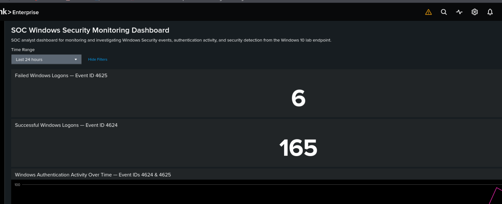
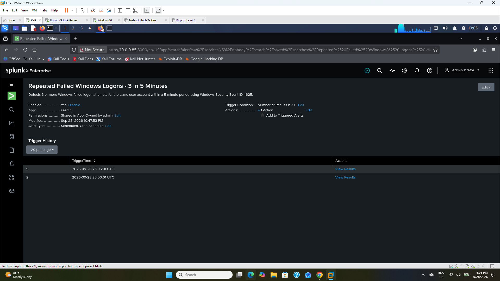

# SOC Analyst Home Lab: Splunk SIEM for Windows Security Monitoring, Detection & Investigation

**Norbert Endoh** · SOC Analyst / Lab Owner · CompTIA Security+ · Completed October 2026
[LinkedIn](https://www.linkedin.com/in/norbert26)

I built an end-to-end SOC workflow in a controlled home lab: Windows Security logs flow into Splunk, custom SPL detections run on a schedule, alerts fire automatically, and I investigate them through to a documented incident disposition.

**Ingestion → Detection → Alerting → Investigation → Disposition → Visualization**


*Top of the SOC Windows Security Monitoring Dashboard (last 24 hours): 6 failed and 165 successful logons. The full 12-panel layout is described in the [investigation write-up](docs/03_INVESTIGATION.md).*

---

## Key Results

| Metric | Result |
|---|---|
| Scheduled detections deployed | **5** enabled Splunk alerts |
| Primary detection | 3+ failed logons per user in 5 minutes (Event ID 4625) |
| SOC dashboard | **12 panels**: authentication, privileged logons, account management, process creation, PowerShell |
| Investigation | 3 failed logons (4625) → successful Type 2 logon (4624) → process review (4688) → PowerShell hunt |
| Disposition | True Positive (Authorized/Benign Security Test), closed with an incident record |
| Final health check | **114** Windows Security events ingested in 15 minutes · 5/5 alerts enabled · dashboard live |

---

## Lab Architecture

```text
Windows 10 Endpoint (DESKTOP-4AMTH10)
  Splunk Universal Forwarder
        |
        |  TCP 9997 (WinEventLog:Security)
        v
Ubuntu Server 24.04  -  Splunk Enterprise 10.4.3  (10.0.0.85)
        ^
        |  Splunk Web, TCP 8000
        |
Kali Linux  -  SOC Analyst Workstation
```

| Component | Role |
|---|---|
| VMware Workstation (Windows 11 host) | Hypervisor, bridged lab network |
| Ubuntu Server 24.04 LTS | Dedicated SIEM server running Splunk Enterprise 10.4.3 |
| Windows 10 Pro | Monitored endpoint with Splunk Universal Forwarder |
| Kali Linux | SOC analyst workstation (Splunk Web) |

The endpoint sent 6 sourcetypes: Security, System and Application event logs plus CPU, memory and network performance counters. Detection work focused on `WinEventLog:Security`.

---

## What I Did

### 1. Built and validated the telemetry pipeline
- Deployed Splunk Enterprise on a dedicated Ubuntu server, separating the SIEM from the monitored endpoint.
- Configured a receiving port (TCP 9997) and installed the Universal Forwarder on Windows 10.
- Proved ingestion with SPL (host, sourcetype and Event ID profiling) before building detections. → [Lab build details](docs/01_LAB_BUILD.md)

### 2. Engineered a brute-force detection (Use Case 01)
- Established a baseline, generated controlled failed logons, and isolated the new 4625 events.
- Built threshold logic, fixed a multivalue `Account_Name` problem with `mvindex`, excluded machine accounts, and generalized the rule beyond the test user.
- Operationalized it as a scheduled alert (every 5 minutes over the last 15 minutes) and tuned it with **15-minute per-user suppression** to reduce alert fatigue. → [Detection engineering write-up](docs/02_DETECTION_ENGINEERING.md)

### 3. Built a SOC monitoring dashboard and 4 more alerts
- 12 panels covering Event IDs 4624, 4625, 4672, 4688 and 4720–4726, plus group-membership changes.
- Additional alerts: local account creation, administrator group membership addition and change, and PowerShell execution.

| # | Enabled Splunk alert | What it detects |
|---|---|---|
| 1 | Repeated Failed Windows Logons – 3 in 5 Minutes | Brute-force / password guessing (4625, T1110) |
| 2 | Windows Local Account Creation | New local accounts (4720) |
| 3 | Administrator Group Membership Addition | Accounts added to the local Administrators group |
| 4 | Windows Administrator Group Membership Change | Any change to the local Administrators group |
| 5 | Windows PowerShell Execution Detection | PowerShell launched on the endpoint (4688) |

### 4. Investigated a triggered alert to closure
- Correlated 3 failed logons with a successful interactive logon, reviewed post-logon process activity, and ran a targeted PowerShell hunt.
- Documented the incident: severity, evidence, containment and escalation decisions, and disposition. → [Investigation write-up](docs/03_INVESTIGATION.md)


*The "Repeated Failed Windows Logons – 3 in 5 Minutes" alert firing automatically on schedule (Trigger History). All 15 step-by-step screenshots are in the [detection engineering write-up](docs/02_DETECTION_ENGINEERING.md).*

---

## Detection Logic

```spl
index=* host="DESKTOP-4AMTH10" sourcetype="WinEventLog:Security" EventCode=4625
| eval target_user=mvindex(Account_Name,-1)
| where isnotnull(target_user) AND target_user!="" AND NOT match(target_user,"\$$")
| bin _time span=5m
| stats count as failed_logons values(Source_Network_Address) as source
        values(Workstation_Name) as workstation by _time target_user
| where failed_logons>=3
```

All queries are in [`/detections`](detections/): the brute-force rule, the investigation searches, the health check and the telemetry profiling.

---

## Repository Contents

| Folder | Contents |
|---|---|
| [`docs/`](docs/) | Lab build, detection engineering and investigation write-ups with evidence screenshots |
| [`detections/`](detections/) | SPL detection, investigation and health-check queries |
| [`images/`](images/) | Evidence screenshots (Splunk searches, alert configuration, trigger history, dashboard) |
| [`reports/`](reports/) | Master project summary, final investigation and validation report, project showcase (PDF) |

## Skills Demonstrated
Splunk Enterprise · Splunk Universal Forwarder · SPL · Windows Security Event Logs (4624, 4625, 4672, 4688, 4720–4726, 4732, 4733) · Detection Engineering · Scheduled Alerts · Throttling & Suppression · SOC Dashboards · Alert Triage · Authentication Correlation · Process-Creation Analysis · Incident Documentation · SIEM Health Validation · MITRE ATT&CK (T1110 Brute Force)

## Related Project
**Vulnerability Management Home Lab** (see my pinned repositories): Nessus assessment, validation, remediation and verified rescanning (actionable findings reduced 40.7%).

---

> **Scope:** This is a personal, controlled home-lab project. All test activity was generated intentionally on lab systems I own. It shows hands-on SOC workflow practice at lab scale; it does not represent production SOC employment.
