# Detection Use Case 01: Repeated Failed Windows Logons

**Goal:** Detect 3 or more failed Windows logons for the same user within 5 minutes (Windows Security Event ID 4625), then turn the detection into a tuned, scheduled Splunk alert.

The aim was not to label every failed logon as malicious. It was to prove the telemetry path, detect the behavior reliably, and operationalize the rule the way a SOC would.

**MITRE ATT&CK:** T1110 – Brute Force

```text
Baseline -> Controlled test -> Validate ingestion -> Build SPL -> Refine & generalize
         -> Schedule alert -> Verify firing -> Tune suppression
```

---

## 1. Establish a baseline
Before generating any test activity, I counted existing Event ID 4625 records on the endpoint. **Result: 3 events.** Having a clean before-state means new activity can be separated from historical data.

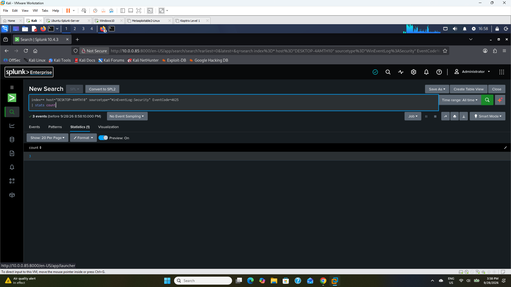

## 2. Generate controlled failed logons
On the Windows 10 VM, I entered an incorrect password for the lab account `labuser` three times. The activity was intentional, known and timestamped.

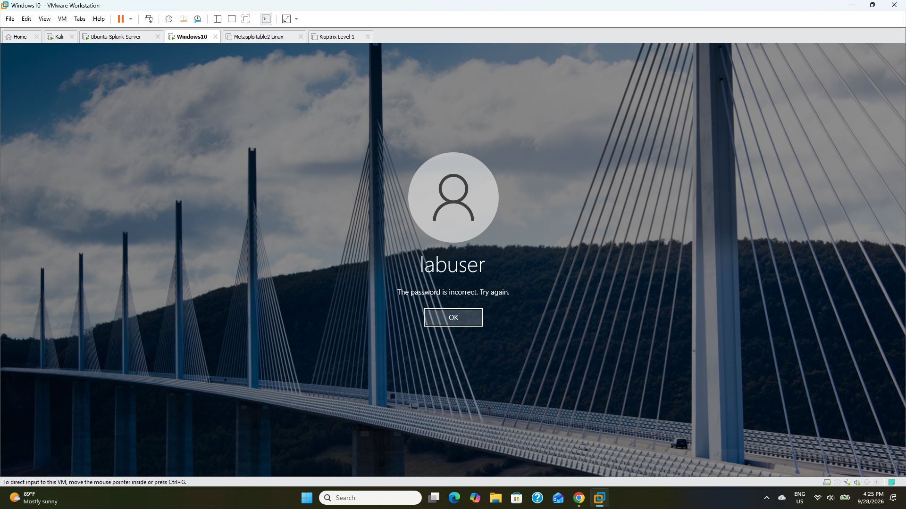

## 3. Validate ingestion
Re-running the same count returned **6 events (3 → 6)**: exactly three new failures had travelled endpoint → forwarder → TCP 9997 → Splunk index.

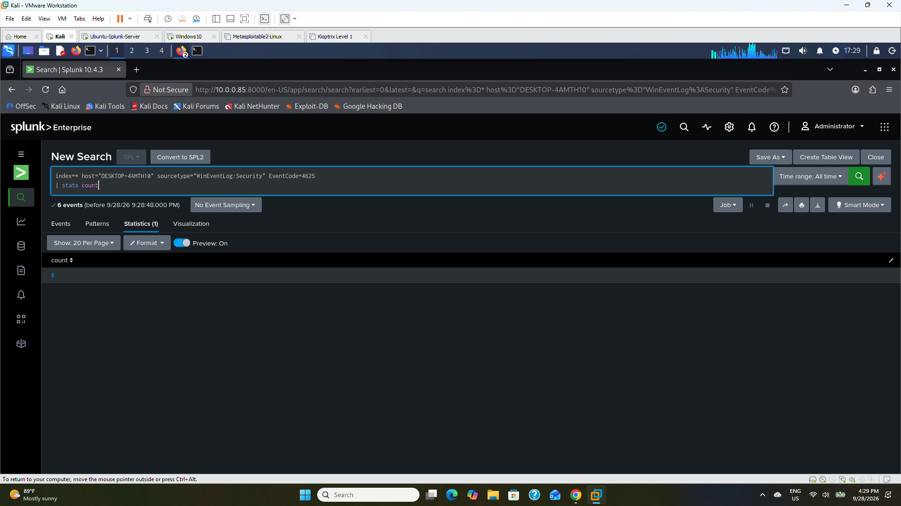

## 4. Isolate and inspect the new events
I sorted the 4625 events newest-first and checked the key triage fields. All three matched the test: `labuser`, Logon Type 2 (interactive), source `127.0.0.1`, workstation `DESKTOP-4AMTH10`, reason "Unknown user name or bad password".

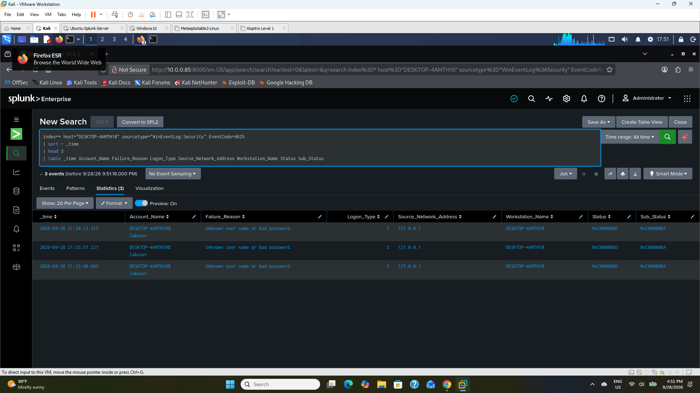

## 5. Build the first threshold detection
I grouped failures into 5-minute buckets and kept results with 3 or more. The rule fired, but it exposed a **multivalue `Account_Name` field**: Windows records both the machine account and the user account.

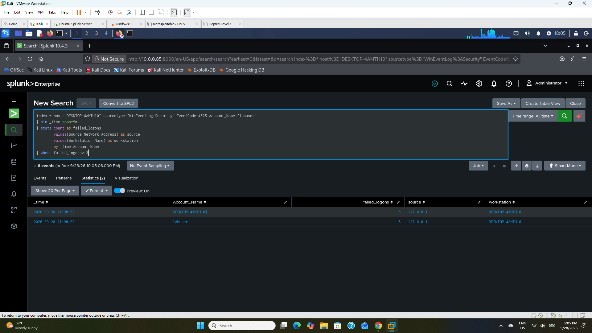

## 6. Fix the field-quality issue
I created a clean `target_user` field with `mvindex(Account_Name,-1)`, so the alert names the intended account.

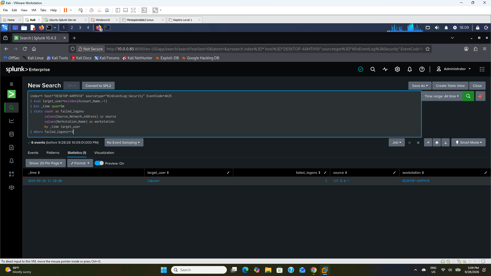

## 7. Generalize beyond the test account
I removed the hard-coded `labuser` filter and excluded empty values and machine accounts (names ending in `$`), so the rule monitors every user.

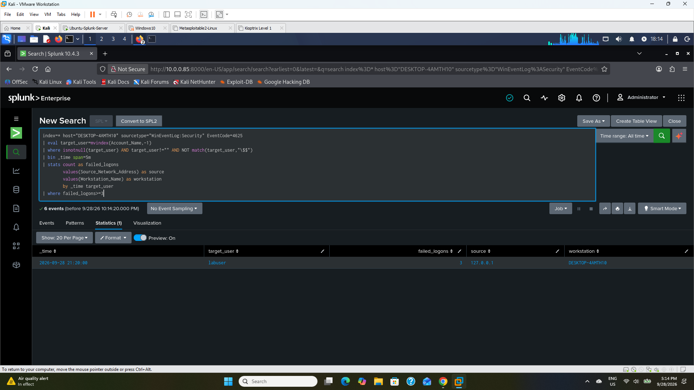

## 8. Move to an operational time window
Switching from *All time* to *Last 15 minutes* returned zero results. That was a timing issue, not a broken rule: the earlier test events were outside the window.

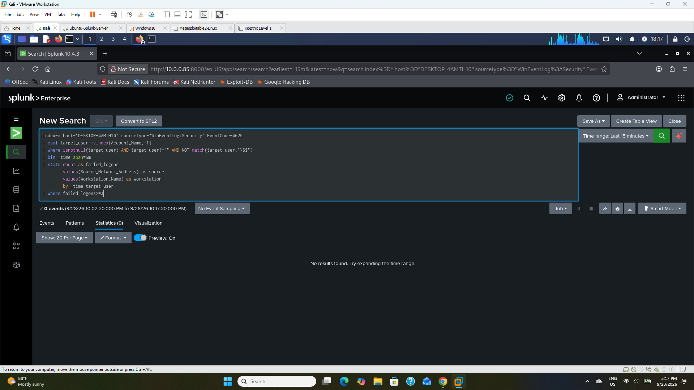

## 9. Re-validate with fresh activity
I generated three new failures and ran the rule over the last 15 minutes. It returned `labuser`, 3 failures, source `127.0.0.1`.


## 10. Operationalize as a scheduled alert

| Setting | Value |
|---|---|
| Alert name | Repeated Failed Windows Logons – 3 in 5 Minutes |
| Schedule | Cron `*/5 * * * *` (every 5 minutes) |
| Search window | Last 15 minutes |
| Trigger | Number of results > 0, once |
| Action | Add to Triggered Alerts |
| Severity | Medium (raised to High at final validation) |

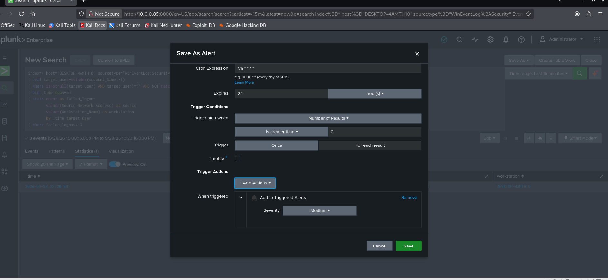
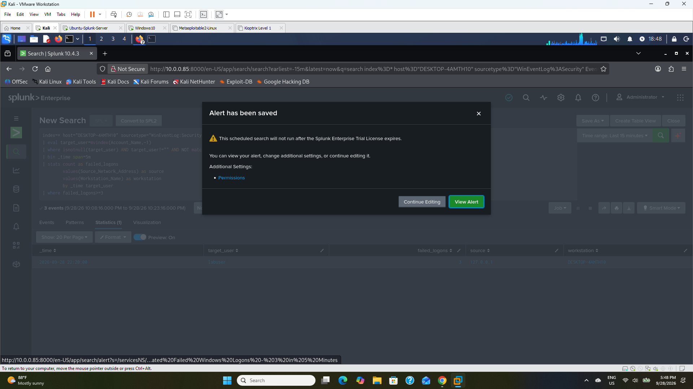

## 11. Verify automatic firing
After generating fresh failures, I waited for the 5-minute cron boundary. Trigger History recorded automatic firings, and the results showed `target_user=labuser`, `failed_logons=3`.


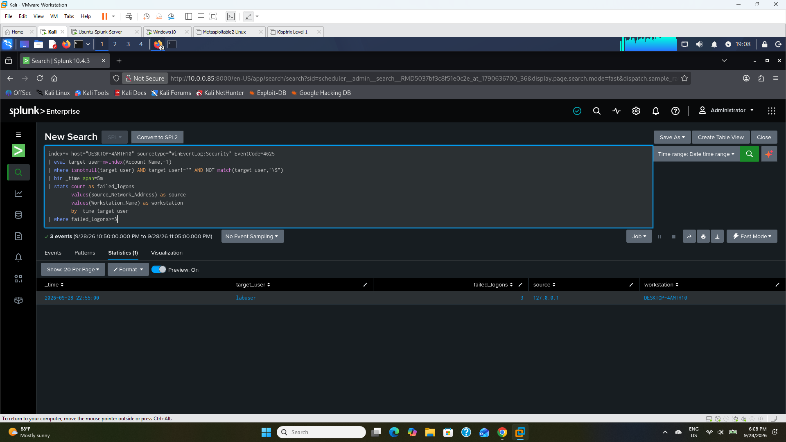

## 12. Tune duplicate alerts
Because a 15-minute window is searched every 5 minutes, the same activity could alert up to three times. I enabled **throttling by `target_user` for 15 minutes**, then confirmed no duplicate trigger entries appeared during the suppression period.

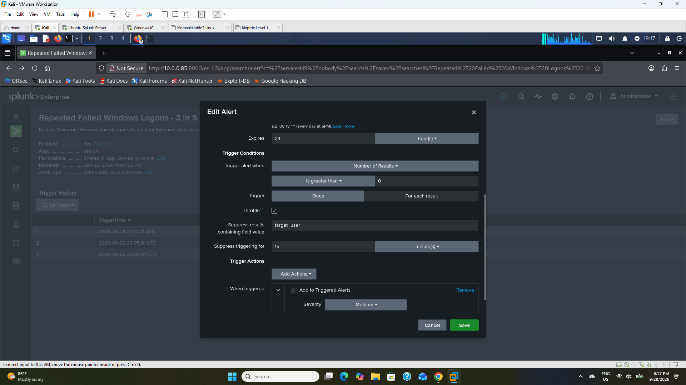
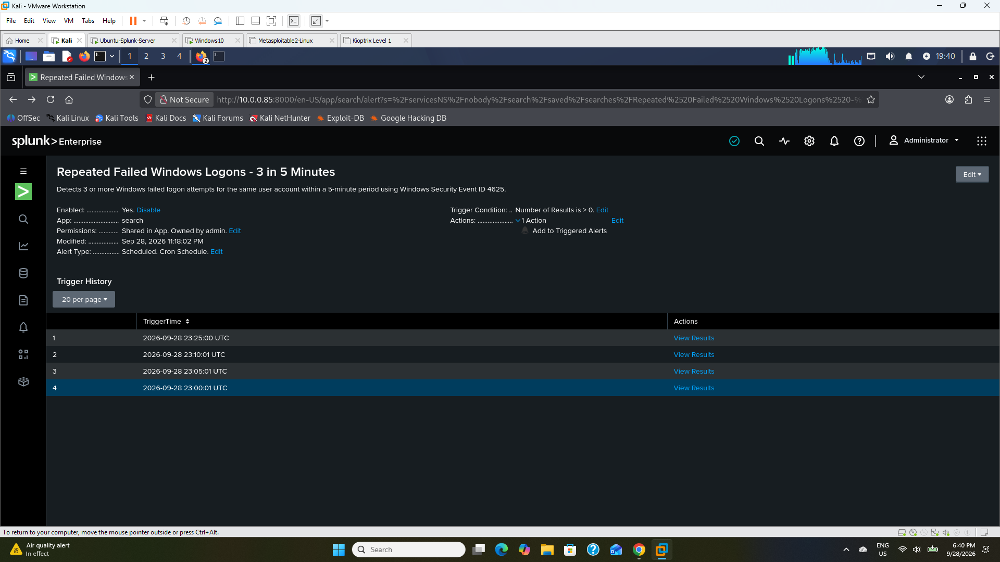

---

## Final Detection

```spl
index=* host="DESKTOP-4AMTH10" sourcetype="WinEventLog:Security" EventCode=4625
| eval target_user=mvindex(Account_Name,-1)
| where isnotnull(target_user) AND target_user!="" AND NOT match(target_user,"\$$")
| bin _time span=5m
| stats count as failed_logons
        values(Source_Network_Address) as source
        values(Workstation_Name) as workstation
        by _time target_user
| where failed_logons>=3
```

**Skills shown:** SPL, Windows Event ID 4625 analysis, baselining, ingestion validation, multivalue field normalization, threshold detection, detection generalization, relative-time search design, cron scheduling, alert validation, and noise reduction through per-user suppression.

[← Back to project overview](../README.md)
