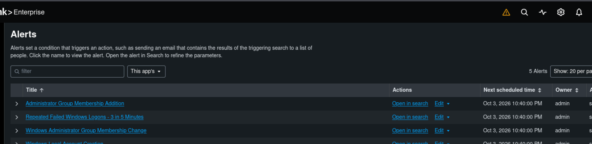

# SOC Dashboard, Alert Investigation & Final Validation

## SOC Windows Security Monitoring Dashboard
A single analyst view with a time-range picker and drill-down investigation tables:

- Failed Windows logons (4625) and successful Windows logons (4624)
- Authentication activity over time (4624 and 4625)
- Failed logons by user · Top Windows Security Event IDs
- Failed and successful logon investigation details
- Account management events (4720–4726) · Account creation and deletion · Local group membership changes
- Privileged/special logon activity (4672)
- Process creation activity (4688) · PowerShell execution activity · Process investigation details

At final validation (last 24 hours), the dashboard showed **6 failed** and **165 successful** Windows logons.


## Enabled Detections (5)

| Alert | Purpose |
|---|---|
| Repeated Failed Windows Logons – 3 in 5 Minutes | Brute-force / password-guessing behavior (T1110) |
| Windows Local Account Creation | New local accounts (4720) |
| Administrator Group Membership Addition | Privilege escalation through group changes |
| Windows Administrator Group Membership Change | Changes to the local Administrators group |
| Windows PowerShell Execution Detection | PowerShell launched on the endpoint (4688) |



---

## Incident Investigation

### Triggered alert

| Field | Value |
|---|---|
| Alert | Repeated Failed Windows Logons – 3 in 5 Minutes |
| Severity | High |
| Trigger time | 2026-10-03 18:10:04 UTC (fired automatically by schedule) |
| Target user | labuser |
| Failed logons | 3 |
| Source / workstation | 127.0.0.1 / DESKTOP-4AMTH10 |

### Step 1: Authentication timeline (4625 → 4624)

| Time | Event ID | Meaning | Source | Logon Type |
|---|---|---|---|---|
| 18:05:06 | 4625 | Failed logon | 127.0.0.1 | 2 |
| 18:05:12 | 4625 | Failed logon | 127.0.0.1 | 2 |
| 18:05:17 | 4625 | Failed logon | 127.0.0.1 | 2 |
| 18:05:32 | 4624 | **Successful logon** | 127.0.0.1 | 2 |

Three failures followed by a successful **interactive (Type 2)** logon. In a real environment, that pattern calls for checking what happened next.

### Step 2: Post-logon process review (4688)
A broad 4688 search returned a lot of Windows and service noise, so I narrowed it to `labuser`. The user session showed normal activity: taskhostw.exe, Microsoft Edge, RuntimeBroker.exe, backgroundTaskHost.exe and related Windows components. Splunk forwarder helper processes were recognized as monitoring-agent activity, not user actions.

### Step 3: Targeted PowerShell hunt
A focused search for `powershell.exe` launched by `labuser` returned **no results** in the 30-minute investigation window.

Queries: [`02_investigation_authentication_timeline.spl`](../detections/02_investigation_authentication_timeline.spl) · [`03_investigation_process_activity.spl`](../detections/03_investigation_process_activity.spl) · [`04_investigation_powershell_hunt.spl`](../detections/04_investigation_powershell_hunt.spl)

### Incident record

| Field | Value |
|---|---|
| Title | Repeated failed Windows logons followed by successful authentication |
| Affected account / host | labuser / DESKTOP-4AMTH10 |
| Evidence | Event IDs 4625, 4624, 4688 |
| Severity | High |
| Status | **Closed** |
| Disposition | **True Positive (Authorized/Benign Security Test)** |
| Containment / escalation | Not required |

**Analyst note:** The detection correctly identified the defined behavior (true positive), but the activity was my own authorized test, so the incident was benign. In production, I would confirm with the account owner and check the source system, authentication context and surrounding telemetry before closing or escalating.

---

## Final SIEM Health Validation

| Check | Result |
|---|---|
| Telemetry | **PASS**: 114 Windows Security events received in the final 15-minute window |
| Detections | **PASS**: 5 alerts enabled |
| Dashboard | **PASS**: current authentication and process telemetry displayed |
| End-to-end | **PASS**: ingestion → detection → alerting → investigation → visualization |

```spl
index=* host="DESKTOP-4AMTH10" sourcetype="WinEventLog:Security"
| stats count as Total_Security_Events latest(_time) as Latest_Event
| convert ctime(Latest_Event)
```

[← Back to project overview](../README.md)
